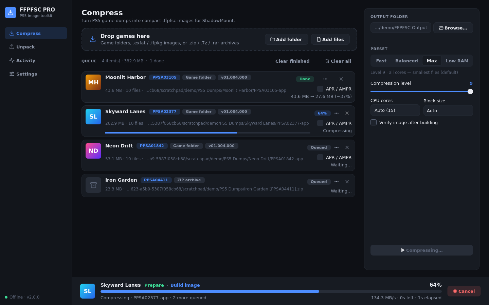
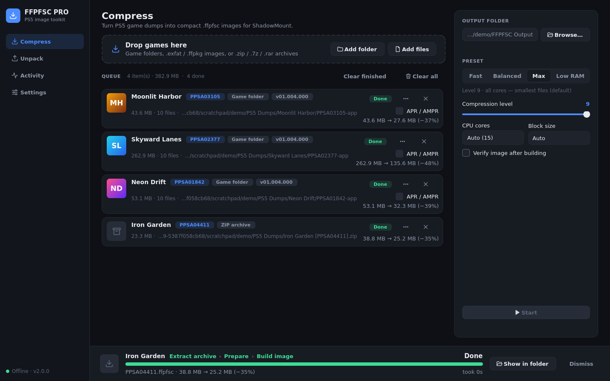
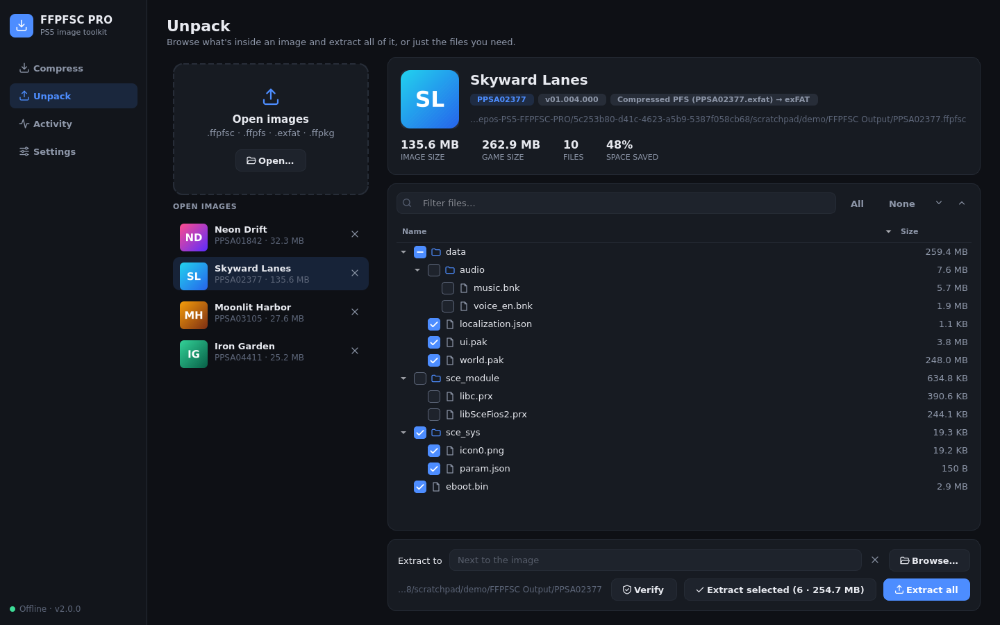
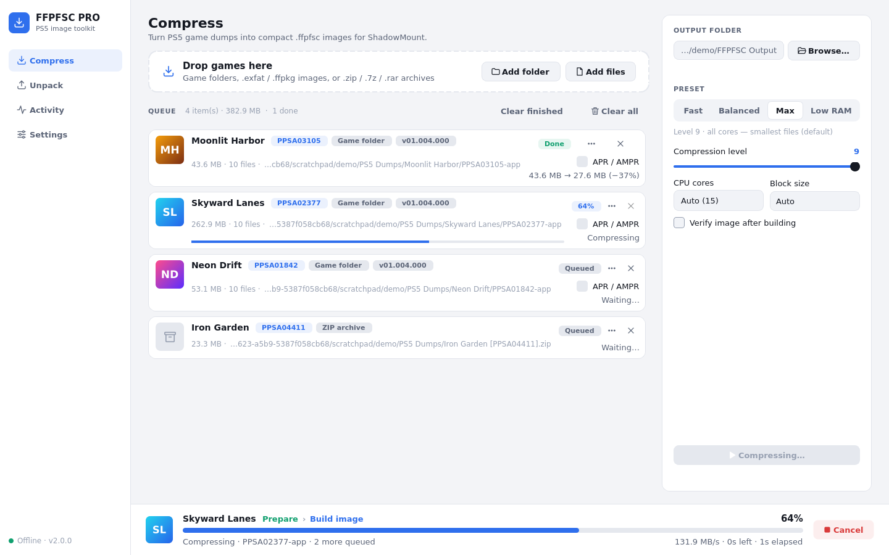
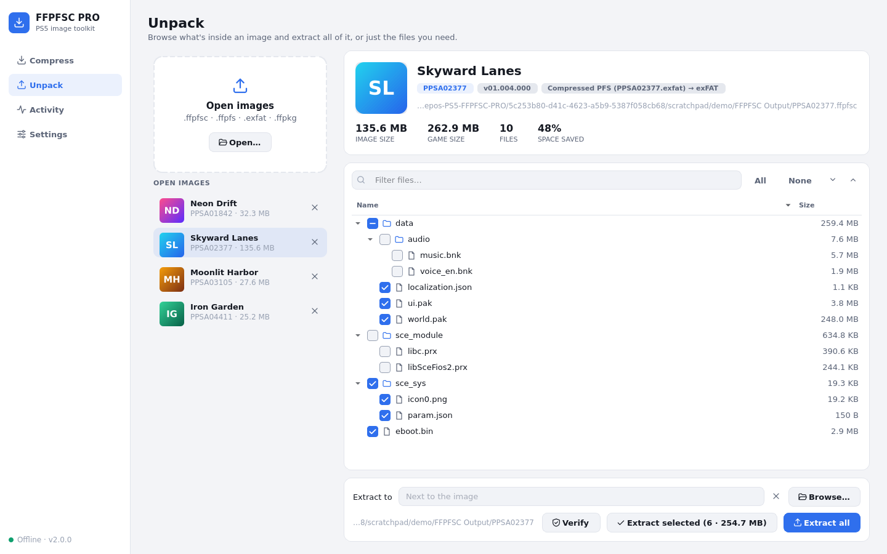
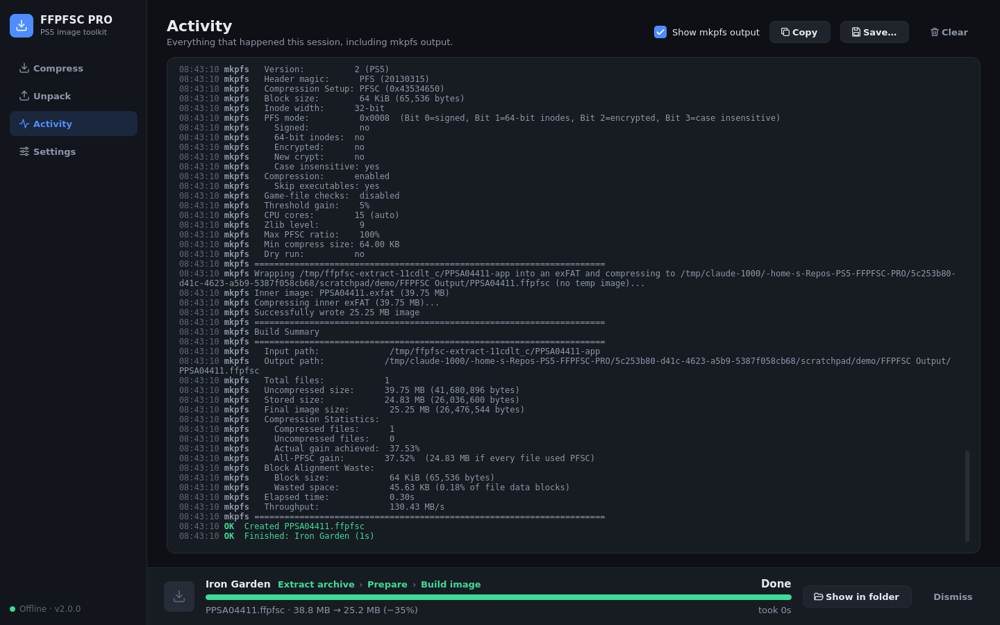
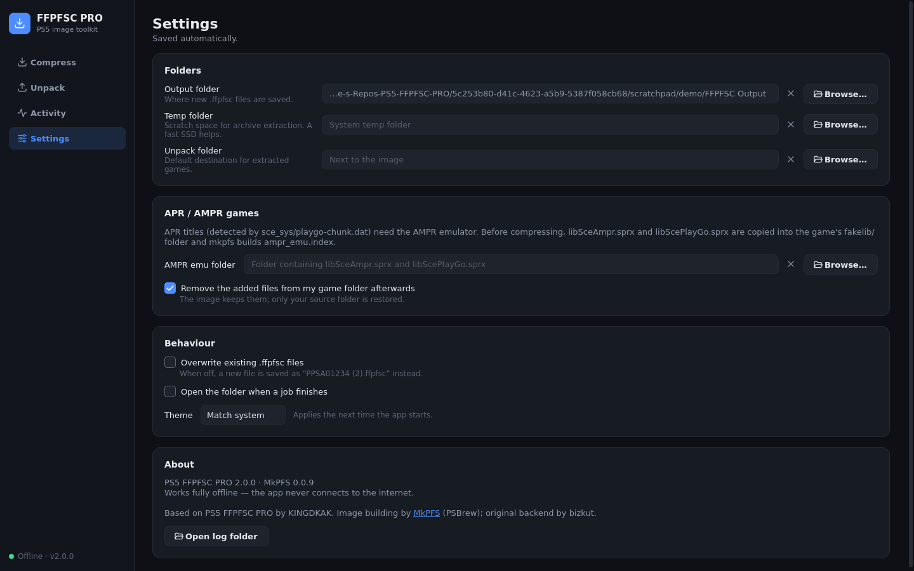

<h1 align="center">PS5 FFPFSC PRO</h1>

<p align="center">
  Compress PS5 game dumps into <code>.ffpfsc</code> images — and unpack them again.<br>
  A fast, modern desktop app for Windows, Linux and macOS. Fully offline.
</p>

<p align="center">
  
  
  
  
  
</p>

<p align="center">
  
</p>

---

## What's new in 2.0

Version 2.0 is a ground-up rewrite of the app around the same MkPFS backend.

- **A new interface.** Built with Qt 6: a sidebar layout, drag and drop anywhere, a live job bar showing stages, speed and ETA, and dark and light themes.
- **Unpack and browse.** Open any `.ffpfsc` and see the game inside: title, icon, title ID, version and the full file tree. Extract everything or just the files you tick. No temp files are needed.
- **Old images open too.** Older `.ffpfsc` files (built before the MkPFS 0.0.9 single-pass pipeline, with a nested `pfs_image.dat` inside) unpack just like new ones.
- **Real verification.** *Verify image after building* reads every file back out of the new image and compares it byte-for-byte with your source.
- **Standalone executable.** The packaged app runs the compression engine itself, so no separate Python installation is needed.
- **Fully offline.** The app never opens a network connection.
- **Safer by default.** Existing output is never overwritten silently (you get `PPSA01234 (2).ffpfsc`). Partial files are cleaned up on cancel or failure, and AMPR files added to your game folder are removed again afterwards.

---

## Screenshots

| Compress | Unpack |
|---|---|
|  |  |
|  |  |
| **Activity log** | **Settings** |
|  |  |

---

## Features

### Compress
- Drop **game folders**, **`.exfat` / `.ffpkg` images** or **`.zip` / `.7z` / `.rar` archives**. You can drop one or a whole folder of games; dumps are found automatically (a folder containing `eboot.bin` and `sce_sys/`).
- Queue as many games as you like. Each row shows the game's icon, title, title ID and version.
- **Presets:** *Fast*, *Balanced*, *Max* and *Low RAM*, or tune the compression level, CPU cores and block size yourself.
- Live progress through every stage (*Extract archive → Prepare → Build image → Verify*), with throughput and time remaining.
- **Out-of-memory protection.** Very large games automatically use fewer cores. If a job still runs out of RAM, it's retried with half the cores.
- Archives are extracted to your temp folder and cleaned up afterwards. Password-protected archives are detected and you're asked for the password.
- Pre-flight checks warn about FAT32 output drives (4 GB file limit) and low disk space.

### Unpack
- Open `.ffpfsc`, `.ffpfs`, `.exfat` and `.ffpkg` images, several at once.
- See the game's icon, title, ID and version, the image size vs. game size, and how much space compression saved.
- Browse the full file tree with sizes, filter by name, and tick exactly what you want.
- **Extract all** or **Extract selected**. Files stream straight from the compressed image to disk, so memory use stays low even for 100 GB games.
- **Verify** checks the image structure and decodes every file, testing the checksum of each compressed block (see [Verification](#verification)).

### APR / AMPR games
APR titles are detected automatically through `sce_sys/playgo-chunk.dat`, and you can tick **APR / AMPR** on any game by hand. Before compressing, `libSceAmpr.sprx` and `libScePlayGo.sprx` are copied into the game's `fakelib/` folder, and MkPFS builds `ampr_emu.index`. Set the folder holding those two files once in **Settings**. By default they're removed from your source folder again when the job finishes; the image keeps them.

---

## Download

Prebuilt apps are attached to each [release](https://github.com/minusxne/PS5-FFPFSC-PRO/releases):

| Platform | File | Notes |
|---|---|---|
| Windows 10/11 (x64) | `PS5-FFPFSC-PRO-Windows-x64.zip` | Unzip and run `PS5-FFPFSC-PRO.exe`. |
| macOS (Apple Silicon) | `PS5-FFPFSC-PRO-macOS-arm64.zip` | The app is unsigned: right-click → **Open** the first time. |
| Linux (x64) | `PS5-FFPFSC-PRO-Linux-x64.tar.gz` | `chmod +x PS5-FFPFSC-PRO` and run it. |

Releases are built by GitHub Actions whenever a `v*` tag is pushed (see `.github/workflows/build.yml`).

## Run from source

You need **Python 3.11 or newer**.

- **Windows:** double-click `RUN.bat`.
- **Linux / macOS:** run `./run.sh`.

The first start creates a private `.venv` and installs the dependencies from `requirements.txt` (PySide6, zlib-ng, cryptography, py7zr, rarfile). Later starts are instant.

To do it manually:

```bash
python -m venv .venv
.venv/bin/pip install -r requirements.txt      # Windows: .venv\Scripts\pip ...
.venv/bin/python run.py
```

You can also pass files on the command line: `run.py Game.ffpfsc` opens it on the Unpack page, and a game folder goes to the Compress queue.

## Build the executable yourself

- **Windows:** run `BUILD_EXE.bat`. The result is `dist\PS5-FFPFSC-PRO.exe`.
- **Linux / macOS:** run `./build.sh`. The result is `dist/PS5-FFPFSC-PRO` or `dist/PS5-FFPFSC-PRO.app`.

Both use `ps5ffpfsc.spec` (PyInstaller) and produce a single file with no Python dependency.

---

## Formats

| You have | What it is | Compress | Unpack / browse |
|---|---|:---:|:---:|
| Game folder (`eboot.bin`, `sce_sys/`) | A raw PS5 dump | ✅ | — |
| `.exfat` / `.ffpkg` | A raw exFAT image of a game | ✅ | ✅ |
| `.zip` / `.7z` / `.rar` | An archive containing a dump or image | ✅ | — |
| `.ffpfsc` (MkPFS 0.0.9+, this app) | Compressed PFS → exFAT | output | ✅ |
| `.ffpfsc` (older builds) | Compressed PFS → nested PFS (`pfs_image.dat`) | — | ✅ |
| `.ffpfs` | Plain PFS image | — | ✅ |

Output files are named after the title ID, for example `PPSA01234.ffpfsc`. Copy them to your PS5's internal storage or a USB drive, then open ShadowMount and let it scan.

## Compression settings

| Preset | Level | Cores | Block size | Use it when |
|---|:---:|:---:|:---:|---|
| Fast | 3 | Auto | Auto | You want results quickly and don't mind slightly larger files |
| Balanced | 6 | Auto | Auto | A good default for most games |
| **Max** (default) | 9 | Auto | Auto | You want the smallest files |
| Low RAM | 6 | 1 | 16 KiB | Your PC has little memory, or a game keeps running out of RAM |

**Block size:** *Auto* uses 64 KiB blocks. *Auto-fit* picks the block size that wastes the least padding, which helps games with many small files.

## Verification

There are two different checks, and they catch different things:

| Check | Where | What it does |
|---|---|---|
| **Verify image after building** | Compress options | Reads every file back out of the finished image and compares it byte-for-byte with the source. This is the strongest check, but it needs the original files. |
| **Verify** | Unpack page | Checks the image structure, then decodes every file. Every *compressed* block carries a zlib checksum, so truncated copies and damaged compressed data are caught. Blocks stored *uncompressed* (data that doesn't compress, such as already-compressed game assets) have no checksum in the format, so damage there can only be found by comparing with the original files. |

---

## Troubleshooting

| Problem | Fix |
|---|---|
| **"No RAR extractor found"** | RAR needs an external tool. Install [7-Zip](https://www.7-zip.org/) or WinRAR (Windows), or `unrar` / `7zip` / `bsdtar` (Linux/macOS). ZIP and 7z work out of the box. |
| **Output drive is FAT32** | FAT32 can't store files over 4 GB. Choose an NTFS, exFAT, APFS or ext4 drive. |
| **Out of memory** | The app retries automatically with fewer cores. If it keeps happening, use the *Low RAM* preset. |
| **Linux: the app doesn't start under X11** | Qt 6 needs `libxcb-cursor0` (Debian/Ubuntu: `sudo apt install libxcb-cursor0`). Wayland sessions work without it. |
| **Something failed** | Open **Activity**: it has the full log, including MkPFS's own output. **Settings → Open log folder** has the logs of the last 10 sessions to attach to a bug report. |

---

## For developers

```
ps5ffpfsc/
  core/            Qt-free logic
    games.py         game/source detection, param.json, APR detection
    image_reader.py  layered reader for every image format; browse, extract, verify
    archives.py      zip / 7z / rar extraction with progress
    worker.py        job worker subprocess (compress / unpack / verify)
  ui/              PySide6 interface
    runner.py        runs jobs in the worker, tracks progress, retries, cancels
    compress_page.py, unpack_page.py, activity_page.py, settings_page.py
    jobbar.py, widgets.py, theme.py, icons.py
backend/mkpfs/     vendored MkPFS 0.0.9 (pinned: the image reader uses its internals)
tests/             pytest suite (core, worker subprocess and offscreen UI tests)
```

**How jobs run.** The app re-launches itself as `--worker` for every job and sends it a JSON job description. The worker runs MkPFS in-process, routes its progress bars into structured events on stdout, and reports partial outputs so they can be cleaned up. Running jobs in a separate process keeps the window responsive, lets **Cancel** stop MkPFS's whole process tree immediately, and means an out-of-memory crash can never take the UI down.

**Tests.** Fixtures are built with MkPFS, covering every image layout, including the old nested format:

```bash
pip install pytest
QT_QPA_PLATFORM=offscreen pytest -q
```

---

## Credits

- Original **PS5 FFPFSC PRO** by [KINGDKAK](https://github.com/KINGDKAK/PS5-FFPFSC-PRO). This version is a fork and rewrite of that project.
- Image building by [**MkPFS**](https://github.com/PSBrew/MkPFS) (PSBrew).
- Original command-line backend by [bizkut](https://github.com/bizkut/ps5-ffpfs-cli).
